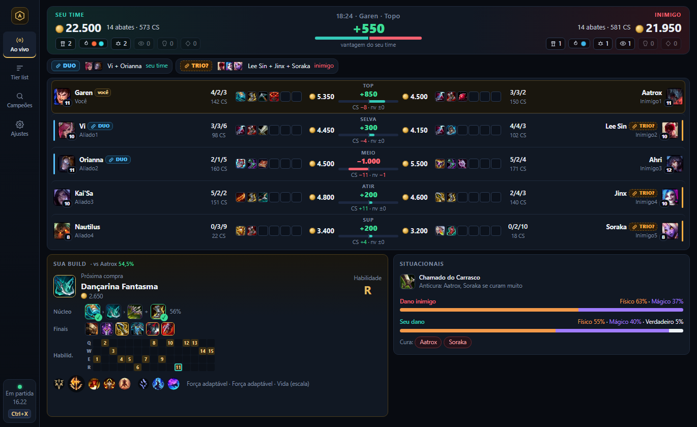
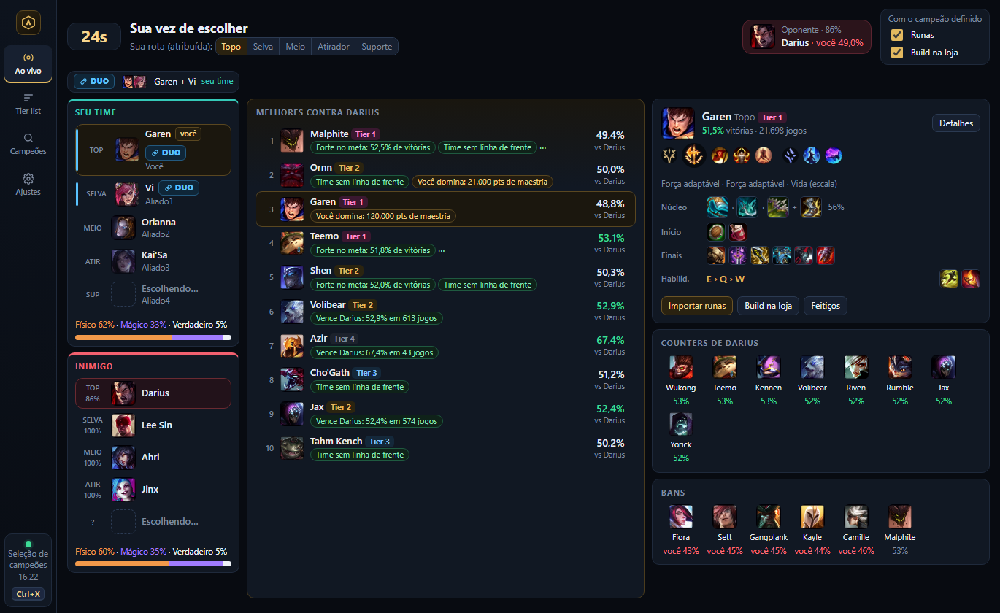
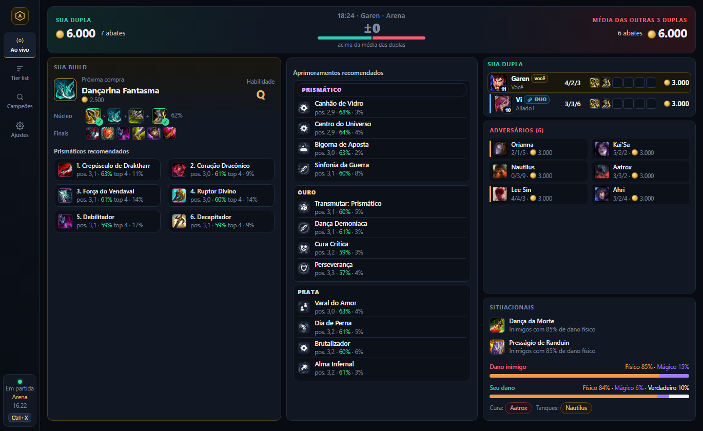

# Analisador LoL

Assistente **leve** para League of Legends, no estilo Porofessor/Blitz: sugere campeões na seleção, mostra counters,
runas e builds do meta atual, envia a build para a loja do jogo e acompanha a partida em tempo real — sem pesar no jogo.

**[⬇️ Baixar o instalador (Windows)](https://github.com/devsilvver/analisador-lol/releases/latest)**

Criado por **Guilherme Silvestrini** ([@devsilvver](https://github.com/devsilvver)).



## O que faz

- **Seleção de campeões:** as melhores escolhas para a sua rota, pelo meta do patch atual, pelo confronto contra o
  oponente de rota, pela composição do seu time e pela sua maestria. Mostra counters do inimigo, sugestões de ban e o
  elo dos aliados. Clique em qualquer campeão para ver runas, build, habilidades e confrontos.
- **Runas, feitiços e build:** importa para o cliente e envia a build para a **loja do jogo** (pode ser automático ao
  confirmar o campeão), com itens situacionais contra o time inimigo.
- **Durante a partida:** próxima compra, build principal marcando o que você já tem, próxima habilidade, itens
  situacionais (anticura, resistências, penetração, visão), tipo de dano dos dois times, ouro de cada time e de cada
  rota, objetivos (torres, dragões, larvas, arauto, barão), **quem está em duo/trio** e o elo de todos.
- **Todos os modos:** ranqueada, normal, escolha rápida, **ARAM** (compara o seu campeão com o banco de trocas),
  **ARAM com aprimoramentos**, **Arena** (aprimoramentos por raridade, itens prismáticos, sinergia com a dupla/trio),
  URF e Nexus Blitz.
- **Perfil:** seu elo, resumo das últimas partidas, campeões mais jogados, maestrias e histórico recente.
- **Aceitar partidas automaticamente** (opcional).

| Seleção de campeões | Arena |
| --- | --- |
|  |  |

## Sempre à mão, sem atrapalhar

- Fica na **bandeja do Windows** e inicia com o Windows (opcional). O X só esconde; para sair: botão direito no ícone → Sair.
- **Ctrl+X** (configurável) mostra/esconde o app por cima do jogo (modo "Sem bordas" ou "Janela"). O atalho só vale com o
  LoL ou o app em primeiro plano, então o "recortar" dos outros programas continua funcionando.
- Abre sozinho em "Ao vivo" quando a seleção começa e volta para o perfil quando a partida acaba.
- Se a tela travar ou o navegador interno cair, o app se reabre sozinho na bandeja.

## Leve de verdade

- .NET 10 + WebView2 (o navegador que já vem no Windows), interface em HTML/CSS/JS puro, sem framework e sem animações.
- Interface sem GPU (não disputa a placa de vídeo com o jogo) e todos os processos com prioridade abaixo do normal.
- Escondido na bandeja: a tela é congelada e a partida deixa de ser lida — cerca de **0,03% de CPU**.
- Tudo cabe numa janela comum, sem rolar a tela.

## Instalação

1. Baixe o `AnalisadorLoL-Instalador-x.y.z.exe` na página de [Releases](https://github.com/devsilvver/analisador-lol/releases/latest).
2. Execute. Não precisa de administrador nem de instalar o .NET (já vem embutido).
3. O Windows pode avisar "O Windows protegeu o computador", porque o instalador não tem assinatura digital paga:
   clique em **Mais informações → Executar assim mesmo**.

Requisitos: Windows 10/11 64 bits e o Microsoft Edge WebView2 (já presente no Windows atualizado; o instalador avisa se faltar).

## Como funciona (e por que é seguro)

| Dado | Origem |
| --- | --- |
| Seleção de campeões, runas, conjuntos de itens, elo, perfil, histórico | API local do cliente do LoL (LCU) |
| Partida em andamento | Live Client Data API da Riot (`https://127.0.0.1:2999`), somente leitura |
| Nomes, ícones, itens, runas (pt-BR) | Riot Data Dragon; aprimoramentos da Arena: CommunityDragon |
| Taxas de vitória, builds, runas, counters, aprimoramentos | API pública do op.gg (cache de 6 h) |

O programa usa apenas as APIs locais oficiais: **não lê a memória do jogo, não injeta nada e não altera arquivos do LoL**.
O atalho usa um gancho de teclado do Windows que só fica ativo com o LoL ou o app em primeiro plano e só reage à
combinação escolhida.

## Compilar a partir do código

Requer o SDK do .NET 10.

```
dotnet publish -c Release -r win-x64 --self-contained false -p:PublishSingleFile=true -p:IncludeNativeLibrariesForSelfExtract=true -o dist
```

Instalador (Inno Setup 6): gere a versão completa e compile o script.

```
dotnet publish -c Release -r win-x64 --self-contained true -p:PublishSingleFile=true -p:EnableCompressionInSingleFile=true -p:IncludeNativeLibrariesForSelfExtract=true -p:DebugType=none -o instalador/app
ISCC.exe instalador\AnalisadorLoL.iss
```

### Estrutura

```
src/Program.cs          entrada (instância única, reabertura automática)
src/MainForm.cs         janela, WebView2, bandeja, vigia de travamento, modo leve
src/KeyboardWatcher.cs  atalho de teclado em linha de execução própria
src/Engine.cs           laço principal, perfil, elo, grupos, importações para o cliente
src/Analyzer.cs         sugestões de pick/ban, rotas, leitura da partida
src/Situational.cs      itens situacionais e tipo de dano dos times
src/MetaService.cs      Data Dragon, CommunityDragon e op.gg com cache em disco
src/Modes.cs            modos de jogo (ranqueada, ARAM, Arena, URF, Nexus Blitz)
src/LeagueClient.cs     API do cliente (LCU) e API da partida ao vivo
wwwroot/                interface (embutida no executável)
instalador/             script do instalador (Inno Setup)
```

Dados do usuário: `%APPDATA%\AnalisadorLoL` (configurações) e `%LOCALAPPDATA%\AnalisadorLoL` (cache e registro).

## Licença

[MIT](LICENSE) — use, modifique e redistribua à vontade, mantendo o aviso de copyright.

---

Analisador LoL isn't endorsed by Riot Games and doesn't reflect the views or opinions of Riot Games or anyone officially
involved in producing or managing Riot Games properties. Riot Games, and all associated properties are trademarks or
registered trademarks of Riot Games, Inc.

O Analisador LoL não é endossado pela Riot Games. League of Legends e todas as propriedades relacionadas são marcas
comerciais ou registradas da Riot Games, Inc. Estatísticas fornecidas pelo op.gg, sem afiliação.
